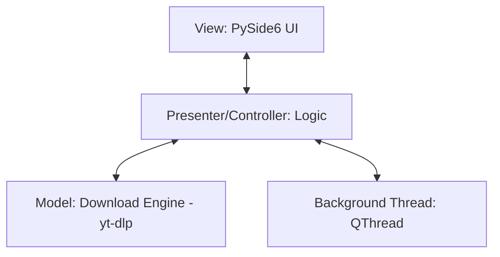

# FB Media Downloader - Technical & Engineering Guidelines (.agent)

This document defines the technical standards, architectural patterns, and engineering rules for building the Facebook Media Downloader Windows application.

## 1. Tech Stack & Core Libraries

- **Programming Language**: Python 3.10+
- **GUI Framework**: `PySide6` (Qt 6 for Python)
  - *Optional UI Enhancements*: `qfluentwidgets` (for a modern, premium Windows 11 Fluent Design look) or `CustomTkinter` (for lightweight modern UI). We default to `PySide6` + custom modern QSS stylesheets or `qfluentwidgets` for an extremely professional feel.
- **Download Engine**: `yt-dlp` (The most robust, actively maintained library for fetching media from Facebook and 1000+ other sites).
- **Asynchronous Execution**: `QThread` / `QThreadPool` & `QRunnable` (Essential to prevent GUI freezing during downloads or scraping).
- **Packaging**: `PyInstaller` — standalone `.exe` on Windows, `.deb` on Ubuntu/Debian, `.app`/`.dmg` on macOS (see section 5).

---

## 2. Architecture & Design Patterns

We follow the **MVP (Model-View-Presenter)** or **MVVM** pattern adapted for desktop development:

### Core Architecture Rules:
1. **Never Block the Main GUI Thread**: All network requests, scraping, and file downloads MUST run in background threads using `QThread` or `QThreadPool`.
2. **Signal-Based Communication**: Background threads must communicate with the main UI thread exclusively using Qt Signals (`PySide6.QtCore.Signal`).
3. **Modular Business Logic**: The download engine (`yt-dlp` integration) must be decoupled from the UI widgets so it can be tested independently.

---

## 3. UI/UX Design Standards (Premium Experience)

To ensure a **WOW** factor and premium feel:
- **Theme Support**: Built-in Dark Mode and Light Mode with smooth transitions.
- **Micro-animations**: Hover states on buttons, smooth progress bar updates, and transition animations for tab switching.
- **Smart Clipboard Monitoring**: Auto-detect when a Facebook URL is copied to the clipboard and offer to paste/analyze it instantly.
- **Clear Progress Feedback**: Show real-time download speed (MB/s), estimated time of arrival (ETA), size, and a progress bar.
- **Download History**: A persistent list of downloaded media with open-file and open-folder shortcuts.

---

## 4. Code & Development Standards

- **Type Hinting**: All functions and methods must use Python type hints (`def download(url: str) -> bool:`).
- **Error Handling**: Gracefully handle network timeouts, invalid URLs, and private videos. Display user-friendly error dialogs instead of crashing.
- **Clean Code**: No hardcoded secrets, clear variable names, and minimal comments—letting the clean code speak for itself.
- **Logging**: Implement a standardized logging system using Python's `logging` module to help debug issues.

---

## 5. Deployment & Packaging Rule

- Use `PyInstaller` through `AzHomeMediaDownloader.spec` (windowed, no console). Windows builds one-file `.exe`; Linux/macOS build one-folder (required for a clean `.app`).
- PyInstaller cannot cross-compile: build each platform on that platform. Linux → `packaging/build_linux.sh` (`.deb`), macOS → `packaging/build_macos.sh` (`.app` in `.dmg`).
- Include a high-quality icon for the application (`.ico` Windows, `.png` Linux, `.icns` macOS is generated by the build script).
- Ensure all static assets (styles, icons, fonts) are bundled correctly using a relative path helper function (`sys._MEIPASS`).

## 6. Cross-Platform Rules (Windows / macOS / Linux)

- Never call `os.startfile` or `explorer` directly: use `open_path()` / `reveal_in_file_manager()` from `src/utils/helpers.py`.
- Never hardcode `ffmpeg.exe`: use `get_ffmpeg_path()` / `download_ffmpeg()`. Downloaded binaries go to `~/.fb_media_downloader/bin` (the install directory is not writable on Linux/macOS).
- Programs launched from a frozen build must use `_external_env()` (restores `LD_LIBRARY_PATH` overridden by PyInstaller).
- Frozen macOS apps have no system CA path: HTTPS code must use `certifi` (see `_ssl_context()`).
- Keep user data under `~` (`config.py` already does); no `APPDATA`/registry.
